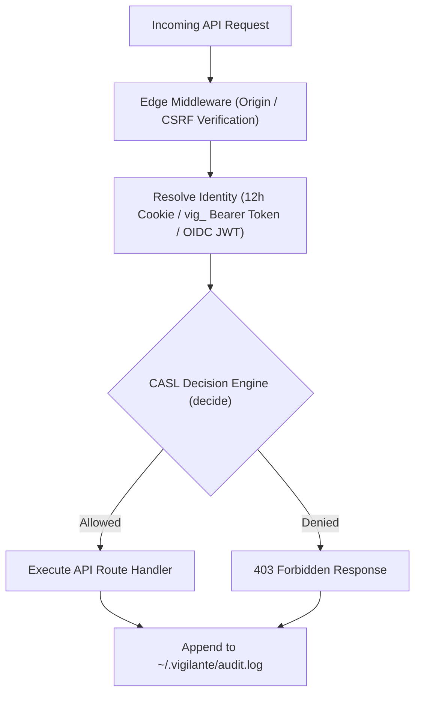

export const metadata = {
  title: "Web Portal & Access Control (CASL Authz) | Vigilante Docs",
  description: "Complete guide to the Next.js 14 Web Operations Portal and the CASL RBAC/ABAC authorization engine in Vigilante.",
};

# 🖥️ Web Operations Portal & Access Control (CASL Authz)

**Vigilante** features a full-featured browser operations portal built with **Next.js 14 (App Router)** and **Tailwind CSS** that operates alongside the terminal console with 100% operational parity. All 26+ API routes are guarded by a fail-closed **CASL-backed RBAC/ABAC authorization engine**.

---

## 1. Web Operations Portal Overview (`apps/web`)

The Web Operations Portal provides deep, visual cyber operations across all 3 NIST incident response phases:

| Route | View Name | NIST Phase | Primary Capabilities |
| :--- | :--- | :--- | :--- |
| **`/`** | Operations Hub | Phase 1: Readiness | Global status, live ingress links, and workflow dispatcher |
| **`/event`** | CTF Player Field Manual | Cyber Range | Workspace initialization, player workflow, and CTF Solver Workbench |
| **`/ctf`** | kCTF Cyber Range | Cyber Range | Ephemeral `nsjail` pod sandboxes, Socratic AI mentor, flag submission |
| **`/instances`** | Cluster Manager | Phase 1: Readiness | Manage isolated multi-cluster `k3d` & `k3s` instances and directories |
| **`/values`** | Helm Values Editor | Phase 1: Readiness | Live YAML editor with syntax checking and instance overrides |
| **`/settings/access`** | Access & Audit | Administration | CASL RBAC principal management, scoped grants, and live audit stream |
| **`/nastymap`** | NastyMap Recon | Phase 2: Detection | Interactive 2D/3D topology, port matrices, and host CVE dossiers |
| **`/analyst`** | AI Security Analyst | Phase 2: Detection | Socratic LLM triage, ReAct loops, and automated NIST incident manifests |
| **`/pods`** | Live Pods Monitor | Phase 2: Detection | Real-time `-A -o wide` pod status, logs, describe, and container shells |
| **`/battlestation`** | BattleStation Live SOC | Phase 2: Detection | Real-time dual-pane SOC telemetry: Falco eBPF syscalls + Zeek/Suricata IDS |
| **`/forensics`** | PCAP Forensics | Phase 2: Detection | Deep file carving (HTTP/SMB), TLS decryption, and TCP stream assembly |
| **`/lineage`** | Process Lineage Tree | Phase 2: Detection | Kernel-level eBPF process hierarchy and LOLBin anomaly detection |
| **`/sniffer`** | Packet Sniffer | Phase 2: Detection | Live frame dissector with BPF filtering and hex dump viewer |
| **`/graph`** | Attack Graph Explorer | Phase 2: Detection | Directed attack graph with BFS shortest path discovery to crown jewels |
| **`/threatsim`** | Threat Simulator | Phase 3: Containment | Automated MITRE ATT&CK injection batches testing SIEM detection rules |
| **`/purpleteam`** | Purple Team Arena | Phase 3: Containment | Multi-agent autonomous Red vs. Blue adversarial wargames with MTTD/MTTR |
| **`/deception`** | Deception Mesh | Phase 3: Containment | Deploy honeytoken ServiceAccounts, canary Secrets, and in-process traps |
| **`/audit`** | Shift-Left Audit | Phase 3: Containment | Manifest and Dockerfile static analysis with SARIF v2.1.0 generation |

---

## 2. CASL RBAC & ABAC Security Architecture

Vigilante's authorization engine (`packages/vigilante_lib/src/engine/authz.js`) is modeled after enterprise zero-trust systems, enforcing capabilities via `@casl/ability`.



### Roles & Default Permissions

| Role | Target Identity | Default Capabilities |
| :--- | :--- | :--- |
| **`owner`** | Lead Operator / Admin | Complete system control (`*`), including `users:manage_permissions`. Protected by the `assertNotLastOwner` invariant (cannot delete or disable the last owner). |
| **`admin`** | Infrastructure Engineer | All security operations: cluster management, module deployments, scans, forensics, and SOAR containment. (Excludes managing other users). |
| **`operator`** | SOC Analyst / Contestant | Scan execution, forensic analysis, CTF arena access, threat simulations, and telemetry write access. |
| **`viewer`** | Read-Only Auditor / Spectator | Read-only access to cluster state, pods, topology, telemetry, and CTF scoreboard. |
| **`webhook`** | Automated CI/CD Pipelines | Scoped to automated scan runs (`scans:run`) and threat simulation triggers (`simulations:run`). |

---

## 3. Scoped Grants (ABAC) & Explicit Revocations

Beyond standard role definitions, individual principals can receive **Attribute-Based Access Control (ABAC)** grants or explicit revocations:

### Scoped Grants
Principals can be granted specific permissions scoped by:
- **`moduleId`**: Restricts actions to specific security modules (e.g. only `kctf` or `openvas`).
- **`namespace`**: Restricts actions to specific Kubernetes namespaces (e.g. `ctf-sandboxes` or `tenant-alpha`).
- **`clusterName`**: Restricts actions to designated cluster instances.

### Explicit Revocations
Subtract sensitive capabilities from a role default (e.g. an `operator` who is denied `forensics:run`).

---

## 4. Fail-Closed Persistence & Credential Invariants

- **Store Path**: `~/.vigilante/authz.yaml` (enforced with POSIX `0600` file permissions).
- **Fail-Closed Guarantee**: If the store is uninitialized or invalid, all mutating operations and remote API routes are strictly denied.
- **Passwords**: Hashed with **scrypt** using recommended parameters ($N=16384, r=8, p=1$) requiring $\ge 12$ characters.
- **API Tokens**: Prefixed with `vig_` and hashed with **SHA-256**. The raw token is only revealed once upon generation.
- **Browser Sessions**: 12-hour `HttpOnly`, `SameSite=Strict` cookies (`vigilante_session`).
- **Audit Ledger**: All mutating authorization decisions and access denials are appended to `~/.vigilante/audit.log` (size-rotated at 5 MiB across 3 backup generations).

---

## 5. Managing Access via Web UI & CLI

### Web UI Management
Navigate to [http://localhost:3000/settings/access](http://localhost:3000/settings/access) to:
- Enroll new human and service principals.
- Rotate tokens or reset passwords with immediate token reveal banners.
- Configure scoped grants and permission revocations via visual controls.
- Inspect the live, searchable security audit log table.

### CLI Management (`vigilante authz`)
```bash
# Initialize authorization store with initial owner
vigilante authz init --name "Lead Admin"

# List all enrolled principals and active sessions
vigilante authz list

# Add a new operator principal (outputs token once)
vigilante authz add --name "SOC Analyst" --role operator

# Grant scoped permission to a namespace
vigilante authz add --name "CTF Contestant" --role viewer --grant ctf:manage --namespace ctf-sandboxes

# Rotate an existing principal's token
vigilante authz rotate <principal-id>

# Revoke a capability from a principal
vigilante authz revoke <principal-id> cluster:write

# Evaluate permission check for testing
vigilante authz check <principal-id> ctf:manage
```
